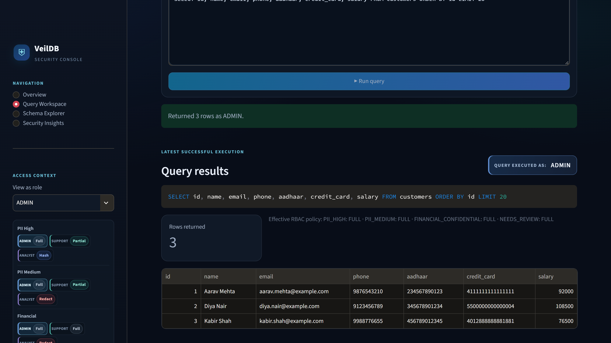
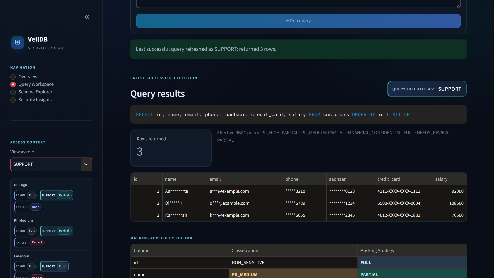
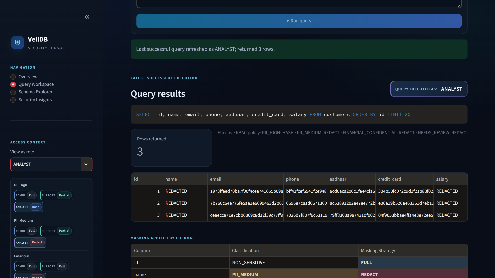
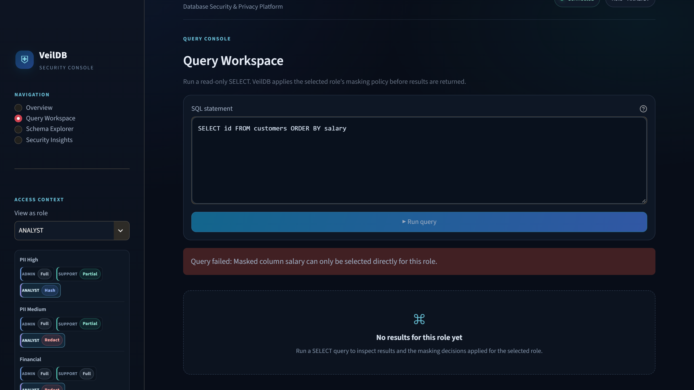
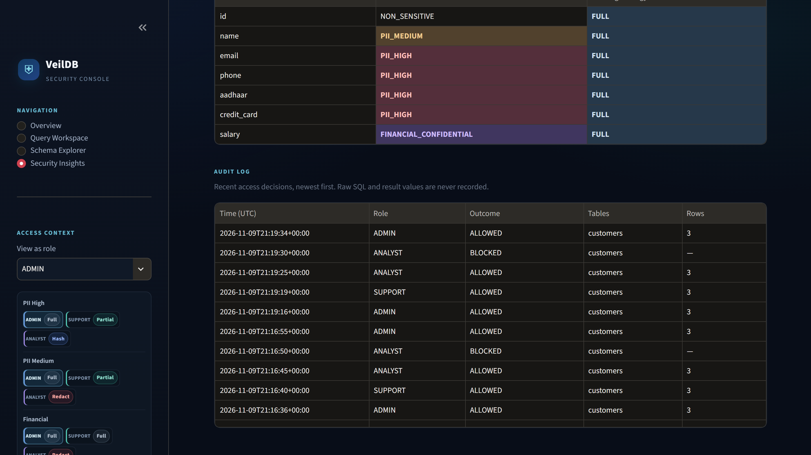

<div align="center">

# 🛡️ VeilDB

### Schema Inspection and Role-Aware PII Masking for SQL Queries

**Protect sensitive database information with intelligent PII detection, role-based access control, and dynamic data masking.**

[](https://veildb.streamlit.app/)
[](https://devpost.com/software/veildb)
[](https://youtu.be/rtrbTFoVNe4)
[](https://datanova-2026-global-data-thon.devpost.com/)
[](https://datanova-2026-global-data-thon.devpost.com/)

[](https://www.python.org/)
[](https://fastapi.tiangolo.com/)
[](https://streamlit.io/)
[](#-testing)
[](LICENSE)

[Live Demo](https://veildb.streamlit.app/) · [Demo Video](https://youtu.be/rtrbTFoVNe4) · [Devpost Submission](https://devpost.com/software/veildb) · [DataNova 2026](https://datanova-2026-global-data-thon.devpost.com/)

</div>

---

## 🏆 DataNova 2026

VeilDB was built for the [DataNova 2026 Global Data-thon](https://datanova-2026-global-data-thon.devpost.com/) in the Cybersecurity & Fraud Detection track. See the full [project submission on Devpost](https://devpost.com/software/veildb).

## 🎬 Demo

Try the [live demo](https://veildb.streamlit.app/) or watch the [demo video](https://youtu.be/rtrbTFoVNe4). The demo uses fictional data only, and the free hosting tier can take about a minute to wake up.

The same query returns different results for each role:

<table>
  <tr>
    <th width="50%">ADMIN: full values</th>
    <th width="50%">SUPPORT: partially masked</th>
  </tr>
  <tr>
    <td></td>
    <td></td>
  </tr>
  <tr>
    <th>ANALYST: hashed or redacted</th>
    <th>Blocked query that could reveal a masked value</th>
  </tr>
  <tr>
    <td></td>
    <td></td>
  </tr>
</table>

Admins can review access decisions in the audit log, which never stores raw SQL or result values:



---

## 📌 Overview

VeilDB is a database security and privacy solution designed to inspect database schemas, identify Personally Identifiable Information (PII), and enforce role-aware masking policies on SQL query results.

It provides an additional security layer between database users and sensitive information, ensuring that users only access data permitted by their assigned roles.

Instead of exposing sensitive information directly, VeilDB applies configurable masking strategies according to data sensitivity and user permissions.

## 🚨 Problem Statement

Modern applications store large amounts of sensitive information, including:

* Personal names and contact information.
* Email addresses and phone numbers.
* Aadhaar and PAN numbers.
* Credit card and financial information.
* Other confidential customer records.

Traditional database access control often focuses on whether a user can access a table rather than what sensitive information they should see within that table.

This creates several challenges:

* Excessive exposure of sensitive information.
* Inconsistent data protection across user roles.
* Difficulty identifying PII across database schemas.
* Risk of accidental disclosure through SQL queries.
* Limited visibility into data masking decisions.

## 💡 Our Solution

VeilDB introduces role-aware data protection through three major capabilities:

1. **Schema Inspection:** Understand database structures and identify potentially sensitive columns.
2. **PII Detection:** Identify sensitive information using classification and pattern validation.
3. **Dynamic Data Masking:** Apply different masking strategies according to user roles and data sensitivity.

## ✨ Key Features

### 1. Schema Inspection

* Inspect database tables and columns.
* Retrieve column metadata.
* Identify potentially sensitive fields.
* Understand the structure of connected databases.

### 2. PII Detection

Detect and classify sensitive information, including:

* Names
* Email addresses
* Phone numbers
* Aadhaar numbers
* PAN numbers
* Credit card information
* Bank account information

### 3. Role-Based Access Control (RBAC)

VeilDB supports different access levels:

| Role    | Access                               |
| ------- | ------------------------------------ |
| ADMIN   | Full access                          |
| SUPPORT | Access according to support policies |
| ANALYST | Restricted access with masking       |

### 4. Intelligent Data Masking

Different masking strategies can be applied depending on the sensitivity and access policy.

* **HASH:** Transform sensitive values into hashed representations.
* **REDACT:** Hide sensitive values.
* **PARTIAL:** Reveal only permitted portions of a value.
* **FULL:** Return the original value to roles permitted to see it.

### 5. SQL Query Processing

* Accept SQL SELECT queries.
* Process queries through the backend.
* Apply role-aware masking policies.
* Return processed results.

### 6. Interactive Dashboard

The Streamlit dashboard provides an interface for interacting with VeilDB, inspecting database information, and viewing query results.

### 7. Query Protection

For roles with masked columns, VeilDB analyzes each query with sqlglot and rejects any query that could reveal a masked value. The database runs the SQL regenerated from the analyzed query.

### 8. Audit Logging

Admins can review each access decision through the API and dashboard. Events never contain raw SQL or result values.

---

## 🏗️ System Architecture

```text
             USER
               |
               v
       VEILDB DASHBOARD
          (Streamlit)
               |
               v
         FASTAPI BACKEND
               |
        +------+------+
        |             |
        v             v
   Schema         SQL Query
  Inspection      Processing
        |             |
        v             v
   PII Detection  Access Control
        |             |
        +------+------+
               |
               v
        MASKING ENGINE
               |
       Role-Based Policies
               |
               v
       PROCESSED RESULTS
               |
               v
          USER DASHBOARD
```

## ⚙️ Technology Stack

| Component         | Technology                                  |
| ----------------- | ------------------------------------------- |
| Backend           | Python, FastAPI                             |
| Frontend          | Streamlit                                   |
| Database          | SQLAlchemy, SQLite demo database            |
| Query Analysis    | sqlglot                                     |
| API Documentation | Swagger / OpenAPI                           |
| Security          | Role-Based Access Control                   |
| PII Detection     | Pattern-based validation and classification |
| Data Protection   | Hashing and masking strategies              |

## 📂 Project Structure

```text
VeilDB/
│
├── backend/
│   └── app/
│       ├── api.py            # FastAPI endpoints and API key authentication
│       ├── audit.py          # Audit trail of access decisions
│       ├── database.py       # SQLAlchemy engine and schema adapter
│       ├── query_engine.py   # SELECT validation, execution, and masking
│       ├── masking/          # Masking strategies
│       ├── scanner/          # PII detection and schema scanning
│       └── security/         # Roles and masking policies
│
├── evaluation/
│   └── evaluate_detector.py  # Detector precision and recall on synthetic data
│
├── docs/images/              # Demo screenshots
│
├── frontend/
│   └── app.py                # Streamlit dashboard
│
├── tests/
│
├── LICENSE
└── README.md
```

---

## 🚀 Getting Started

### Prerequisites

* Python 3.10+
* pip
* Git

No database setup is needed for local use. On first run, the API creates a SQLite database with fictional records.

### 1. Clone the Repository

```bash
git clone https://github.com/papnoivaishnavi/VeilDB.git

cd VeilDB
```

### 2. Create a Virtual Environment

Windows:

```bash
python -m venv venv
venv\Scripts\activate
```

Linux / macOS:

```bash
python3 -m venv venv
source venv/bin/activate
```

### 3. Install Dependencies

Install the dependencies specified by the project's backend and frontend requirements files.

```bash
pip install -r requirements.txt
```

### 4. Start the Backend

Choose your own secret values and set them in both the backend and frontend terminals.

Windows (PowerShell):

```powershell
$env:VEILDB_ADMIN_API_KEY = "<admin-key>"
$env:VEILDB_SUPPORT_API_KEY = "<support-key>"
$env:VEILDB_ANALYST_API_KEY = "<analyst-key>"
$env:VEILDB_HMAC_KEY = "<hash-key>"
```

Linux / macOS:

```bash
export VEILDB_ADMIN_API_KEY=<admin-key>
export VEILDB_SUPPORT_API_KEY=<support-key>
export VEILDB_ANALYST_API_KEY=<analyst-key>
export VEILDB_HMAC_KEY=<hash-key>
```

Without `VEILDB_HMAC_KEY`, the API uses a random key and hashed values change after each restart.

Start the FastAPI application using its configured Uvicorn entry point.

```bash
uvicorn backend.app.api:app --reload --port 8000
```

### 5. Access API Documentation

Once the backend is running:

```text
http://127.0.0.1:8000/docs
```

### 6. Start the Frontend

```bash
python -m streamlit run frontend/app.py
```

Access the dashboard:

```text
http://localhost:8501
```

---

## ☁️ Deployment

The public demo runs the API on Render and the dashboard on Streamlit Community Cloud.

**API (Render Web Service)**

* Build command: `pip install -r requirements.txt`
* Start command: `uvicorn backend.app.api:app --host 0.0.0.0 --port $PORT`
* Environment variables: `PYTHON_VERSION`, `VEILDB_HMAC_KEY`, and the three `VEILDB_*_API_KEY` values
* Leave `DATABASE_URL` unset to use the fictional demo database

**Dashboard (Streamlit Community Cloud)**

* Main file: `frontend/app.py`
* Secrets: `VEILDB_API_URL` and the three `VEILDB_*_API_KEY` values

---

## 🔌 API Endpoints

VeilDB exposes REST API endpoints through FastAPI.

| Method | Endpoint  | Description                     |
| ------ | --------- | ------------------------------- |
| GET    | `/schema` | Inspect database schema         |
| POST   | `/query`  | Execute and process SQL queries |
| GET    | `/audit`  | View recent access decisions (ADMIN only) |

### GET /schema

Retrieves database schema information, including table and column metadata.

Example:

```bash
curl http://127.0.0.1:8000/schema
```

### POST /query

Processes a SQL query through the VeilDB security and masking pipeline.

The role comes from the required `X-API-Key` header, not from the request body.

Example request:

```bash
curl -X POST http://127.0.0.1:8000/query \
  -H "Content-Type: application/json" \
  -H "X-API-Key: <analyst-key>" \
  -d '{"query": "SELECT * FROM customers"}'
```

### GET /audit

Returns recent access decisions, newest first, and requires the ADMIN API key. The optional `limit` parameter accepts 1 to 1000 and defaults to 100.

Each event contains the timestamp, role, outcome (`ALLOWED`, `BLOCKED`, `ERROR`, or `UNAUTHORIZED`), scanned table names, and row count. Raw SQL and result values are never recorded because they can contain personal data.

Events are kept in memory, up to the latest 1000, and written to stdout as JSON. The in-memory list resets when the API restarts and is per process.

```bash
curl -H "X-API-Key: <admin-key>" "http://127.0.0.1:8000/audit?limit=20"
```

---

## 🔐 Security Model

VeilDB uses role-aware policies to determine how sensitive information should be exposed.

Example policy behavior:

| Data Classification | SUPPORT | ANALYST |
| ------------------- | ------- | ------- |
| High PII            | PARTIAL | HASH    |
| Medium PII          | PARTIAL | REDACT  |
| Financial           | FULL    | REDACT  |
| Needs Review        | PARTIAL | REDACT  |

ADMIN has full access under the configured role policy.

For roles with masked columns, a masked column can only be selected directly. Using one in `WHERE`, `JOIN`, `GROUP BY`, `ORDER BY`, or an expression is rejected, as are `UNION` and subqueries.

The Streamlit role selector is a demo convenience. Its process holds all three API keys, so do not expose it to untrusted users with real data. The public demo contains fictional data only.

### Why Role-Aware Masking?

Different users require different levels of information.

For example:

* An administrator may require complete customer information.
* A support representative may need financial details to resolve a customer issue.
* An analyst may need anonymized information to identify trends without accessing raw personal information.

VeilDB makes this distinction part of the query-processing workflow.

---

## 🧪 Testing

Install the test dependencies, then run the project's test suite:

```bash
pip install -r requirements-dev.txt
pytest
```

For individual test modules:

```bash
pytest tests/
```

The suite of 174 tests covers:

* PII detection accuracy.
* Masking strategy correctness.
* Role-based access policies.
* SQL query processing.
* Schema inspection.
* Invalid input handling.
* Sensitive data protection.
* Query bypass attempts.
* Audit logging.

### Detector Evaluation

Run `python -m evaluation.evaluate_detector` to measure column-level detection on randomly generated synthetic data (seed 2026, 20 repetitions, 10 samples per column). A positive means the column is flagged as sensitive.

| Column names | Precision | Recall | F1 |
| ------------ | --------: | -----: | --: |
| Descriptive  | 0.685     | 1.000  | 0.813 |
| Opaque (`col_01`) | 0.615 | 0.727 | 0.667 |

The detector favors over-flagging, which hides more data rather than exposing it. Known limitations: digit-only identifiers and dates can be mistaken for PII, and with opaque column names it cannot detect person names, passport numbers, or numeric salaries. These results come from synthetic data and are not a measure of performance on production databases.

---

## ⚠️ Project Status

VeilDB is a prototype that has been tested on SQLite with fictional data. Connection-level read-only mode is currently implemented for SQLite only, and other databases have not been tested. Audit events held in memory reset when the API restarts.

## 🎯 Use Cases

1. **Financial Applications:** Protect customer financial information.
2. **Healthcare Systems:** Reduce unnecessary exposure of patient information.
3. **Analytics Platforms:** Allow analysts to work with protected datasets.
4. **Enterprise Databases:** Apply role-aware privacy policies.
5. **Customer Support Systems:** Provide access to necessary information without unrestricted exposure.

## 🔮 Future Enhancements

* Automated PII discovery across larger database schemas.
* Support for additional database engines.
* More configurable masking strategies.
* Fine-grained column-level permissions.
* Durable, tamper-evident audit storage.
* Policy management through the dashboard.
* Docker-based deployment.
* Integration with enterprise authentication systems.

## 🤝 Contributing

Contributions are welcome!

1. Fork the repository.
2. Create a feature branch.
3. Implement your changes.
4. Test your implementation.
5. Submit a pull request.

## 👥 Contributors

| Member | Contribution |
| ------ | ------------ |
| Vaishnavi Papnoi | Database connectivity, SQLAlchemy integration, SQL query execution and interception engine, FastAPI backend, Streamlit dashboard, frontend-backend integration, and dashboard UI/UX |
| D. Lidiya | PII detection and classification, sensitive data pattern validation, dynamic masking strategies, and role-based access control (RBAC) |
| Tuan Nguyen | Query security hardening, API key authentication, masking fixes, audit logs, detector evaluation, deployment, presentation, and demo video |

## 🙏 Acknowledgements

VeilDB is built with these open-source projects: FastAPI, Uvicorn, SQLAlchemy, sqlglot, Streamlit, pandas, and Requests. Tests use pytest and HTTPX. All bundled records and evaluation data are fictional. Generative AI tools assisted development, and the demo video narration uses an AI-generated voice.

## 📜 License

Released under the [MIT License](LICENSE).

---

**VeilDB — Protecting sensitive data without compromising accessibility.**
